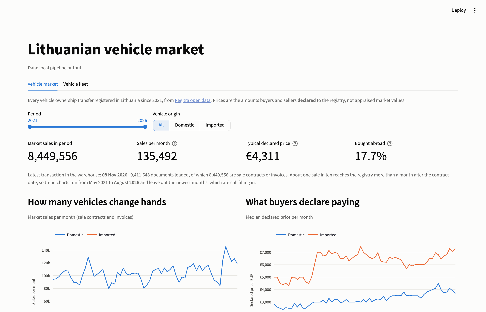
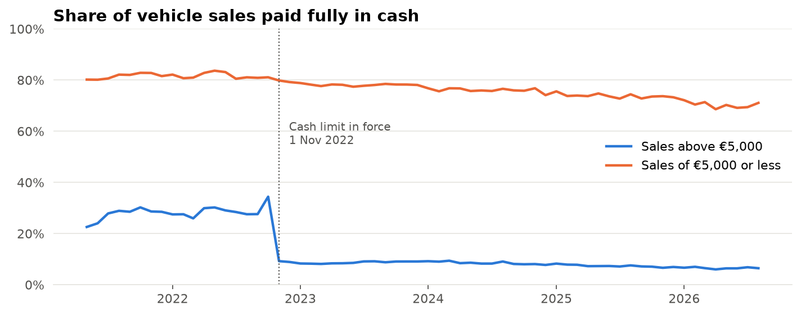
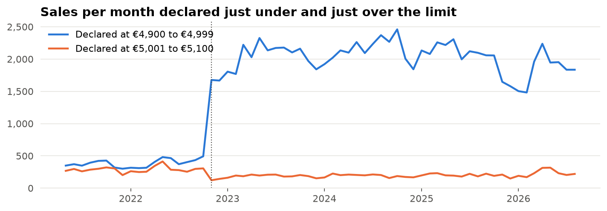
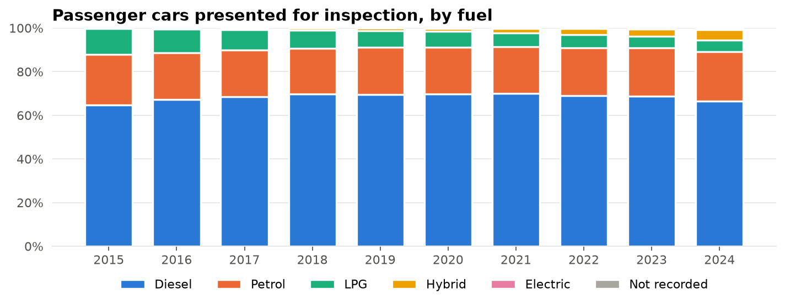
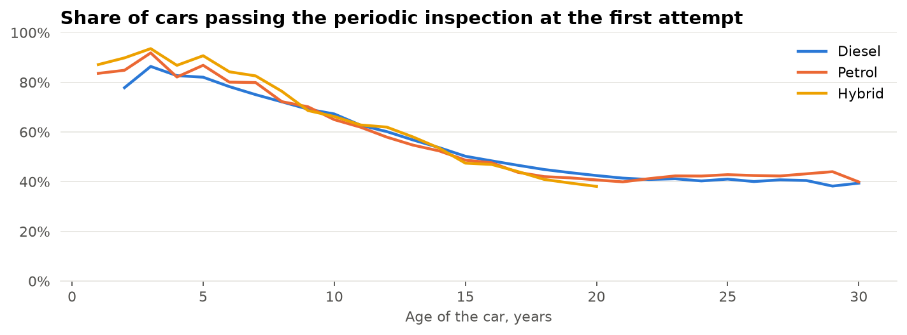
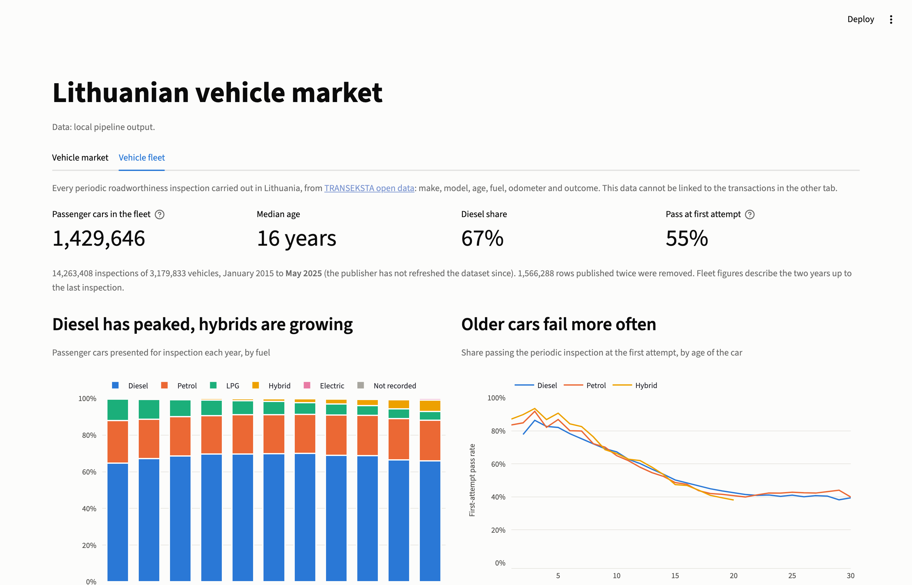
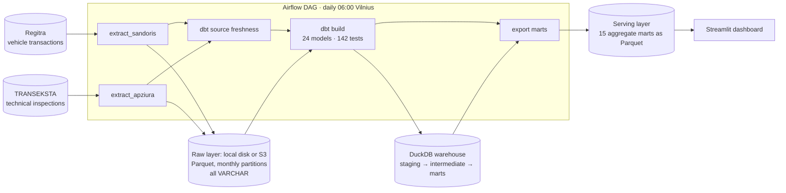
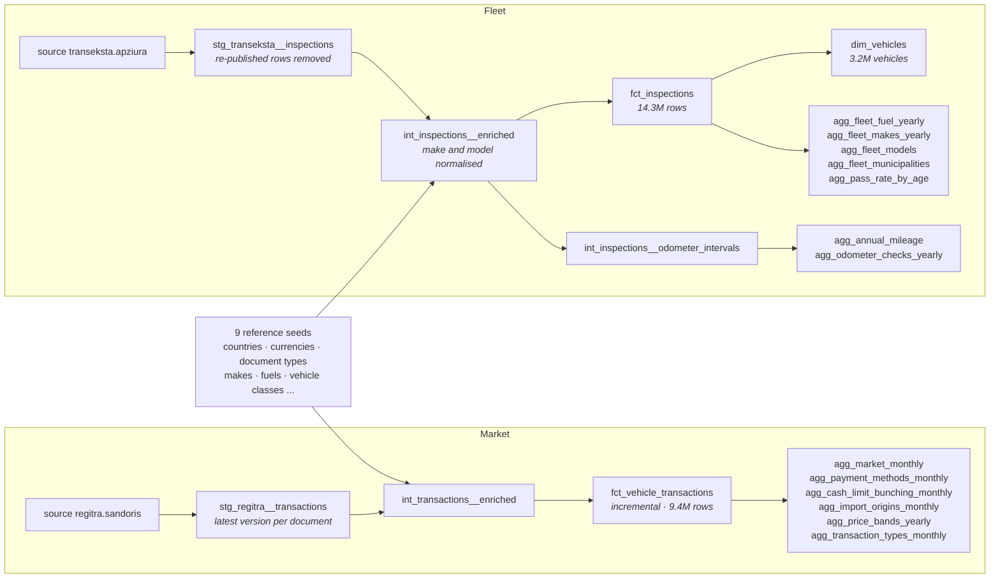

# Lithuanian Vehicle Data Pipeline

[](https://github.com/ismayil-sultanli/lt-vehicle-market-pipeline/actions/workflows/ci.yml)
[](https://lt-vehicle-market.streamlit.app)

**Live dashboard: [lt-vehicle-market.streamlit.app](https://lt-vehicle-market.streamlit.app)**

An end-to-end ELT pipeline over two national open datasets: **every vehicle
ownership transfer in Lithuania since 2021** (9.4 million documents) and **every
technical inspection since 2015** (15.8 million rows). Data is pulled
incrementally from the open data API, landed as Parquet on local disk or S3,
modelled and tested with dbt in DuckDB, orchestrated by Airflow and served to a
Streamlit dashboard.

`Python` · `Airflow 3` · `dbt` · `DuckDB` · `Parquet` · `S3` · `Streamlit` · `GitHub Actions` · `Docker`



## What the data says

Every figure below is produced by [`scripts/build_report.py`](scripts/build_report.py)
from the marts. The full write-up is in [docs/findings.md](docs/findings.md).

**A cash limit changed how cars are paid for within one month.** Lithuania's
Law on Restriction of Cash Payments, in force since 1 November 2022, restricts
cash settlements that exceed €5,000 ([KPMG summary](https://kpmg.com/xx/en/home/insights/2022/11/flash-alert-2022-201.html)).
Cash-paid sales above the limit fell from 34% in October 2022 to 9% in November
and were 6% in August 2026, the latest settled month. Sales of €5,000 or less did not react (81% before, 80% after).



**It also changed what people write on the contract.** Sales declared at €4,900
to €4,999 went from 385 a month to 2,020 a month, a 5.3-fold increase, while
sales declared just above the limit dropped.



**The fleet is old, diesel and slowly electrifying.** 1.43 million passenger
cars were inspected in the two years to May 2025. Their median age is 16 years
and 67% run on diesel. Diesel peaked at 70% in 2021; hybrids and electric cars
grew from 0.3% of inspected cars in 2015 to 5.6% in 2024.



**Almost half of all cars fail their inspection at the first attempt.** A diesel car
passes first time 82% of the time at 5 years old, 67% at 10, 50% at 15 and 42%
at 20. The most common car on the road is the Volkswagen Passat (60,044 cars, median
model year 2006), followed by the Golf, Audi A6, Toyota Avensis and Audi A4.





**Fewer odometers go backwards.** In 2017, 1.80% of cars arrived with a reading
at least 10,000 km lower than at their previous inspection. In 2024 it was 0.51%
(3,099 of 603,501 cars, median gap 82,139 km). Typing errors and replaced
instrument clusters cause such gaps too, so these are anomalies, not proven fraud.

Other results: the typical declared price of a domestic sale rose from about
€2,590 (May 2021 to April 2022) to €3,905 (the latest twelve settled months); 17.7% of sales are recorded abroad, Germany first
(418,479); a 10 to 14 year old diesel covers 13,044 km a year against 8,635 km
for a petrol car.

## Architecture



### Data model



The two subject areas cannot be joined: the publisher pseudonymises vehicle
identifiers separately in each dataset, and the transaction data carries no
vehicle key at all. This was verified against all 2.3 million published vehicle
records (zero matches) rather than assumed.

## Engineering decisions

Longer reasoning, failure modes and a scaling plan are in
[docs/design.md](docs/design.md).

**One generic, idempotent extractor.** A `DatasetSpec` names a dataset, its
columns and the date column its monthly partitions are cut on. Adding the second
source was one catalogue entry and no new extraction code. Each partition is
downloaded to a temp file, checked against the API's own `count()` and
atomically swapped in, so a truncated download can never replace good data. The first run is simply the case
where every partition is missing: 25 million rows in about half an hour.

**Local disk or object storage, same code.** The raw layer sits behind a small
storage interface. Set `LVM_RAW_URI=s3://bucket/prefix` and the extractor
publishes partitions to S3 (or R2, MinIO), and dbt's `s3` target reads them
straight from the bucket. Both paths are tested against an S3 emulator.

**Partition on what cannot change.** Transactions are mutable, so they are
partitioned by *modification* month: a closed month is immutable and only the two
newest partitions are re-pulled. Inspections are append-only and partitioned by
inspection month.

**Raw stays raw.** Landed files are all `VARCHAR`. Typing happens in dbt, where a
bad value becomes a failing test instead of a crashed load.

**Late-arriving data.** A document edited after its first load re-appears in a
newer partition. The raw layer keeps both versions; staging keeps the latest. The
fact table is incremental on *arrival* time. The first version used the source
timestamp as watermark, and the reconciliation test caught it dropping rows after
an out-of-order backfill.

**Hand-typed dimensions.** Inspection stations type the make by hand: 1,577
spellings for passenger cars alone (`VW`, `VOLKSWAGEN, VW`, `BAYER.MOT.WERKE-BMW`,
`Skoda (CZ)`). A normalisation macro plus an alias seed reduce them to fewer
than 80 brands and resolve 99.7% of inspections; a coverage test fails the build
if that drops below 98%.

**The dashboard never touches the warehouse.** `lvm export` publishes 15 small
aggregate Parquet files (about 120 kB). The dashboard reads those from an HTTPS
URL, a local folder, or a snapshot committed to the repository, so it runs
straight after cloning, can be hosted for free, and all business logic stays in
dbt. A dbt exposure documents the dependency and a test keeps the two lists in
sync.

**Run where the source is reachable.** The open data API rejects requests from
GitHub-hosted runners: in a test, all 57 requests from a runner got HTTP 500
while the same requests from a Lithuanian connection, in the same two minutes,
all succeeded. Rather than work around a block the publisher may have chosen, the
pipeline runs where the API is reachable (locally or under Airflow), GitHub
Actions runs only the offline CI, and the hosted dashboard serves a committed
snapshot that `make refresh` updates.

**Airflow orchestrates, it does not compute.** The pipeline lives in its own
virtualenv and the DAG shells out to it, so Airflow's and dbt's dependency trees
never have to agree, and every task can be reproduced with one `make` target.

## Data quality problems found and handled

| Problem | Where | Handling |
|---|---|---|
| 1,566,288 rows published twice (33% of 2018, 38% of 2024) | inspections | De-duplicated on full row content in staging; count reported in `agg_fleet_status` |
| Model name `10"` breaks naive CSV parsing | inspections | CSV dialect pinned to RFC 4180, regression test added |
| About 10% of sales reach the registry more than a month after the contract date | transactions | Newest three months flagged incomplete and kept out of trends and KPIs |
| Payment method often left unstated until the end of 2023 | transactions | Cash shares computed among documents that state a method |
| 210 distinct "countries", including Anguilla with 1,206 sales (likely mis-keyed *Anglija*) | transactions | Seed covers material countries, long tail falls to `Other`, coverage test at 99.5% |
| 874 negative amounts, prices of €1 and of €22 million | transactions | Kept as transactions, excluded from price statistics by a configurable range |
| Odometer of 0 or 6.7 million km, cars built in 1900 | inspections | Set to NULL by range rules covered by unit tests |
| Make masked by the publisher in 3.5% of passenger-car inspections | inspections | Shown as `Not disclosed`, excluded from rankings |
| Coverage starts mid-2021, early months partial | transactions | Flagged with `is_complete_month` |

## Testing

| Layer | What it checks | Count |
|---|---|---|
| Extractor and CLI | partition windows, run planning, CSV schema and dialect, retries, atomic publish, failure isolation | 33 |
| Sample loader | bundled samples land in the same monthly partitions as real extracts | 3 |
| Object storage | extract into an S3 emulator (moto), then dbt builds from the bucket | 2 |
| Dashboard | the real app runs headless (Streamlit AppTest): both tabs, filters, missing data | 4 |
| End to end | real-data fixtures → raw Parquet → full `dbt build` → export; late edits; re-published rows | 3 |
| Airflow | the DAG imports under Airflow 3.4 and has the intended tasks, schedule and retries | 4 |
| dbt unit tests | business rules on fixed inputs: cash-limit boundary, price validity, make normalisation, odometer intervals | 6 |
| dbt data tests | keys, relationships, accepted values and ranges, grain, reconciliation, seed coverage | 136 |
| dbt contracts | column names and types of the marts the dashboard reads | 4 models |

```bash
make test   # everything except the Airflow job; 99% line and branch coverage
make lint   # ruff + mypy --strict
```

CI has three jobs: lint, types and the test suite; the DAG tests under the
pinned Airflow version; and a Docker build that runs the CLI, `dbt parse` and the
DAG import inside the image. No job needs network access to the data sources:
the fixtures are small samples of the real datasets.

## Quick start

Requires Python 3.11+.

```bash
make setup      # virtualenv + dependencies (versions pinned in constraints.txt)
make demo       # the whole pipeline on the bundled sample data, no download, under a minute
make pipeline   # the real thing: extract -> freshness -> dbt build -> export
make dashboard  # http://localhost:8501
```

The first `make pipeline` downloads about 25 million rows (roughly 30 minutes);
later runs take three to four minutes. To try it on a fraction of the data:

```bash
.venv/bin/lvm extract --dataset sandoris --since 2026-09
```

The dashboard alone needs no pipeline run: `make dashboard` falls back to the
snapshot in `dashboard/snapshot/`. After `make demo`, open the demo output with
`LVM_DATA_DIR=data/demo make dashboard`.

Other targets: `make refresh` (re-run everything and update the committed
snapshot, findings and charts), `make figures` (refuses to run on partial data),
`make snapshot`, `make unit`, `make docs` (dbt lineage site), `make help`.

### With S3

```bash
pip install -e ".[s3]"
export LVM_RAW_URI=s3://my-bucket/lt-vehicles AWS_ACCESS_KEY_ID=... AWS_SECRET_ACCESS_KEY=...
lvm extract
DBT_TARGET=s3 dbt build --project-dir dbt --profiles-dir dbt
```

For Cloudflare R2 or MinIO also set `LVM_S3_ENDPOINT_URL`.

### With Airflow

```bash
docker compose up --build   # Airflow on :8080, dashboard on :8501
```

The DAG `vehicle_market_daily` runs both extracts in parallel, then freshness,
`dbt build` and the export. Without Docker it can be executed once with
`airflow dags test vehicle_market_daily`.

### Hosted dashboard

The dashboard runs on Streamlit Community Cloud at
[lt-vehicle-market.streamlit.app](https://lt-vehicle-market.streamlit.app), deployed
as is (main file `dashboard/app.py`, dependencies in `dashboard/requirements.txt`).
It reads the snapshot committed in `dashboard/snapshot/`. To publish newer data,
run `make refresh`, commit the updated snapshot and docs, and push: Streamlit
redeploys from `main`. The app can also read marts from any folder or HTTPS URL
set in `LVM_MARTS_URL`.

## Project layout

```
src/lt_vehicle_market/   dataset catalogue, extractor, storage (local or S3), mart export, CLI
dbt/                     sources, staging, intermediate, marts, seeds, macros, tests
airflow/                 DAG and Docker image
dashboard/               Streamlit app (market and fleet views) and a marts snapshot
scripts/                 findings report and chart generator
tests/                   unit tests and offline end-to-end tests on real-data fixtures
docs/                    design notes, generated findings and charts
.github/workflows/       CI: lint, types, tests, Airflow DAG, Docker image
```

## Data sources

Both are published on the Lithuanian open data portal and pseudonymised by the
publisher; neither contains personal information.

* **AB Regitra**, [*Transporto priemonių sandorių duomenys*](https://data.gov.lt/datasets/2812/)
  (`datasets/gov/regitra/tpsais/Sandoris`): ownership-transfer documents since May 2021.
* **TRANSEKSTA**, [*Transporto priemonių techninės apžiūros duomenys*](https://data.gov.lt/datasets/2721/)
  (`datasets/gov/transeksta/ctadb/Apziura`): technical inspections since 2015.

Both datasets are licensed under
[Creative Commons Attribution 4.0](https://creativecommons.org/licenses/by/4.0/).
The samples in `tests/fixtures`, the marts in `dashboard/snapshot` and every
figure in this repository are derived from them: rows were selected, cleaned,
de-duplicated and aggregated as described above.

## Licence

Code: [MIT](LICENSE). Data: CC BY 4.0, © AB Regitra and TRANSEKSTA, via data.gov.lt.

## Limitations

* **Declared, not market, prices.** Amounts are self-reported and commonly
  understated in private sales. Trends are more trustworthy than levels.
* **Prices cannot be linked to vehicles.** A rising median price can mean dearer
  cars or a different mix of cars; the data cannot tell which.
* **One transaction row is one document**, not one vehicle.
* **The inspection data ends in May 2025.** The publisher has not refreshed it
  since; the freshness check reports this as a warning on every run.
* **The fleet is what gets inspected.** New cars are first inspected after three
  years, and the municipality is that of the station, not of the owner.
* **EUR only for prices.** About 2% of documents are in other currencies; they
  count as transactions but are excluded from price statistics, not converted.
* **Withdrawn records** in closed partitions are only noticed by a `--full-refresh`.
* The cash limit (€5,000, from 1 November 2022) is a dbt variable; changes to the
  limit under discussion in 2026 would be a one-line update.

## Possible next steps

* Convert non-EUR amounts with ECB reference rates.
* Make the transaction staging model incremental (see the scaling notes).
* Move the warehouse itself to MotherDuck or BigQuery.
* Publish the dbt docs site and add volume anomaly tests on daily row counts.
