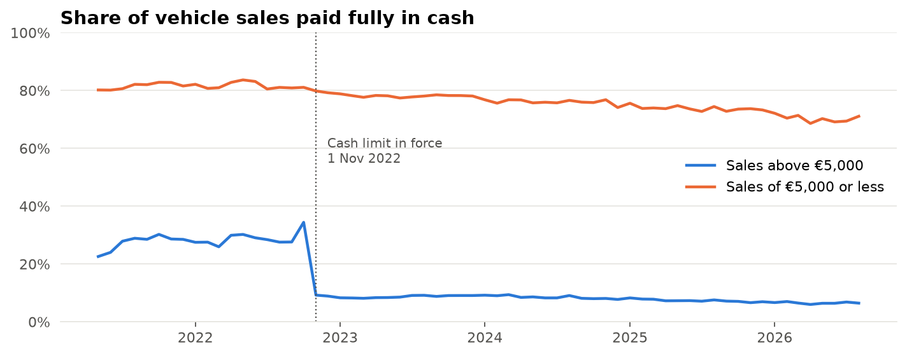
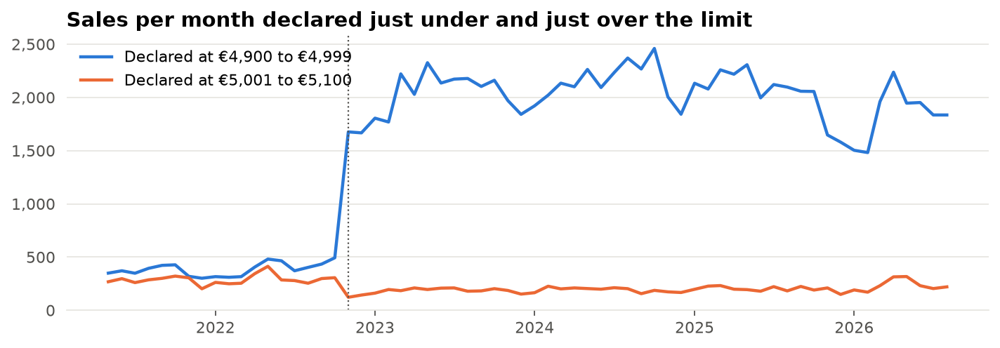
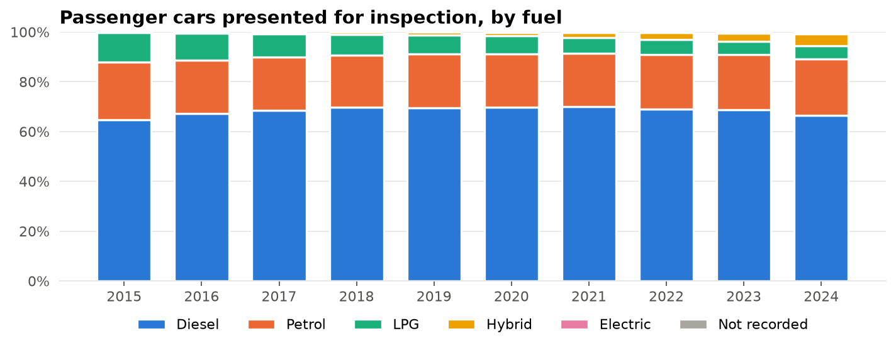
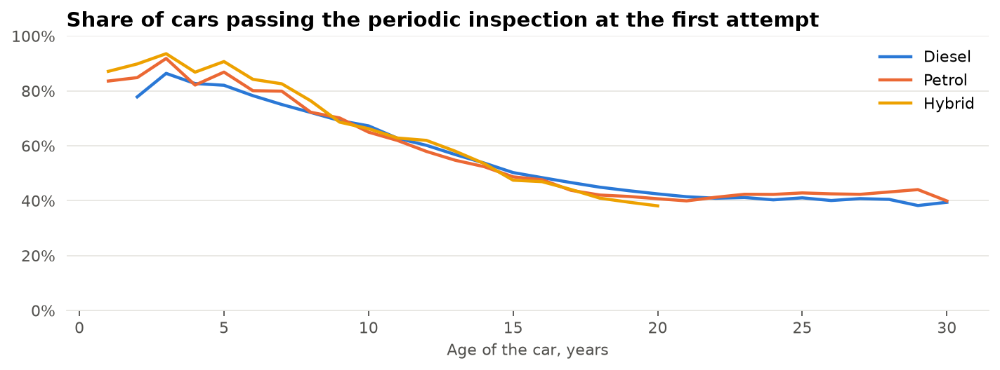

# Findings

Generated by `scripts/build_report.py` from the exported marts. Do not edit by
hand: run `make figures` after a pipeline run.

Data: AB Regitra and TRANSEKSTA via the Lithuanian open data portal, licensed
under [CC BY 4.0](https://creativecommons.org/licenses/by/4.0/); cleaned,
de-duplicated and aggregated by this project.

## Vehicle market (ownership transfers)

Source: AB Regitra, 9,411,648 documents, of which 8,449,556 are sale
contracts or invoices. Trends cover May 2021 to August 2026;
the newest months are left out because registrations keep arriving late. Latest transaction
loaded: 08 November 2026.

### The cash limit changed behaviour within a month

Since 1 November 2022 cash settlements that exceed €5,000 are restricted.

| Share paid fully in cash | October 2022 | November 2022 | August 2026 |
|---|---|---|---|
| Sales above €5,000 | 34% | 9% | 6% |
| Sales of €5,000 or less | 81% | 80% | |

Shares are taken among documents that state a payment method.

### ...and what people write on the contract

Sales declared at €4,900 to €4,999 averaged 385 a month in the year
before the limit and 2,020 a month in the year after, a
5.3-fold increase.

### Declared prices

| Typical declared price | First 12 months | Last 12 settled months |
|---|---|---|
| Domestic sales | €2,590 | €3,905 |
| Vehicles bought abroad | €4,736 | €6,725 |

Monthly medians, weighted by the number of priced sales.

### Where vehicles are bought

17.7% of market sales are recorded in a country other than Lithuania.
Largest origins: Germany (418,479), France (244,717), Poland (116,641), Netherlands (116,346), Belgium (80,868).

## Vehicle fleet (technical inspections)

Source: TRANSEKSTA, 15,829,696 published rows from January 2015 to
May 2025. 1,566,288 rows that the publisher released twice were removed,
leaving 14,263,408 inspections of 3,179,833 vehicles.

### The current fleet

1,429,646 passenger cars were inspected in the two years to May 2025.
Their median age is 16 years, 67% run on diesel and
55% pass the periodic inspection at the first attempt.

### Fuel mix

| Share of inspected passenger cars | 2015 | 2024 |
|---|---|---|
| Diesel | 65% | 66% |
| Hybrid or electric | 0.3% | 5.6% |

Diesel peaked at 70% in 2021 and has been falling since.

### Makes and models

Most common makes in 2024: Volkswagen (109,654), Toyota (73,903), Audi (66,036), BMW (61,035), Opel (51,191).

| Most common models | Cars | Median year |
|---|---|---|
| Volkswagen Passat | 60,044 | 2006 |
| Volkswagen Golf | 40,055 | 2005 |
| Audi A6 | 23,445 | 2006 |
| Toyota Avensis | 23,342 | 2007 |
| Audi A4 | 22,594 | 2006 |

### Age and roadworthiness

A diesel car passes at the first attempt 82% of the time at 5 years old,
67% at 10, 50% at 15 and 42% at 20.

### Mileage

A 10 to 14 year old diesel car covers a median of 13,044 km a year, a petrol car of
the same age 8,635 km.

In 2024, 3,099 of 603,501 cars
(0.51%) arrived with an odometer reading at least 10,000 km lower than at
their previous periodic inspection; the median gap was 82,139 km. In
2017 the share was 1.80%. Typing errors, replaced
instrument clusters and readings taken in miles produce such gaps too, so these are anomalies
worth a second look, not proven tampering.

### Municipalities

Among municipalities with at least 5,000 inspected cars, the youngest fleet is in
Vilniaus m. sav. (median 13 years) and the oldest
in Ignalinos r. sav. (median 19 years). The largest,
Kauno m. sav., has a median of 14 years. The
municipality is that of the inspection station, not of the owner.
